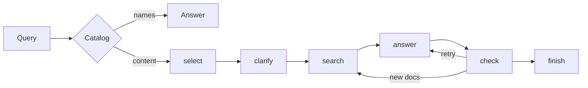

# multiagent-rag

Локальный поиск по своим документам, без интернета. Ответ пишет Qwen2.5-1.5B на процессоре. Похожесть текста считает модель `multilingual-e5-small`. Поиск идёт двумя списками, Chroma и поиск по словам, и складывает их в один. Сеть для ответа не нужна.

## Запуск

Из корня репозитория:

```powershell
.\start.ps1          # 1.5B, http://127.0.0.1:8000
.\start.ps1 restart  # остановить процесс на порту 8000 и запустить снова
.\start.ps1 big      # та же команда, но модель 7B, если файл уже лежит в data/models
```

Один вопрос из консоли, без страницы:

```powershell
$env:PYTHONPATH = "src"
python -m cli --user ИМЯ ingest --kb ИД data/inbox
python -m cli --user ИМЯ сколько насосов в цехе
```

Пока индекс строится, страница открывается сразу. Список диалогов берётся из сохранённого файла. Дерево документов обновляется, когда `/ready` отвечает 200.

## Как устроен вопрос

Вопрос «какие документы загружены» отвечает списком имён файлов и модель не вызывает. Остальные вопросы идут по цепочке:



Проверка может вернуть ответ на переписывание не больше двух раз. Если после этого ответ не подтверждён, человек видит «В документах нет ответа.» Вопрос «сколько» может остаться с числом из обзорной строки таблицы.

## Где что лежит

| Путь | Зачем |
| --- | --- |
| `data/inbox` | Исходные файлы. В индексе они лежат плоским списком, папки только на странице. |
| `data/chroma` | Индекс для поиска по смыслу. |
| `data/ui/workspace.json` | Диалоги, оценки 1–5 и дерево папок. В git не входит. |
| `data/models` | Файлы моделей. Файл 7B не удалять. |
| `config/` | Лимиты, когда отвечать списком файлов, словарь проверки чисел. |
| `data/prompts/` | Текст, который видит модель перед ответом, и примеры. |
| `src/` | Код. Названий и фактов из ваших документов здесь быть не должно. |

## Части системы

- [Загрузка документов](docs/ingest.md)
- [Индекс и поиск](docs/store.md)
- [Сборка вопроса](docs/coordinator.md)
- [Выбор прошлого хода](docs/select.md)
- [Уточнение вопроса](docs/clarify.md)
- [Ответ](docs/answer.md)
- [Проверка ответа](docs/check.md)
- [Страница и запросы](docs/api.md)
- [Диалоги и папки](docs/workspace.md)
- [Страница](docs/ui.md)
- [Модель](docs/llm.md)
- [Настройки и тексты для модели](docs/settings.md)
- [Как измерять качество](docs/eval.md)

## Что нельзя ломать

Не записывать в `src/` имена файлов и факты из них. То, что зависит от конкретных документов, живёт в `config/` и `data/prompts/`.

Не опускать нижнюю границу в `tests/eval/floors.json` и не передавать `--write-floors` / `--raise-floors`, пока об этом не попросили и проверка не написала, что порог пройден. `tests/eval/last.json` и `pytest tests/test_floors.py` качество заново не меряют: они сравнивают уже записанные числа.

После правки `src/`, `config/` или `data/prompts/` заново измерить то, что сдвинулось. Как именно — в [docs/eval.md](docs/eval.md).
