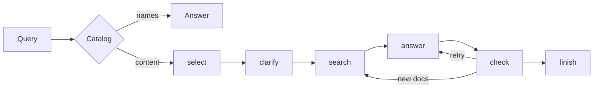

# multiagent-rag — обзор

> **Аудитория:** технические партнёры, новые контрибьюторы, интеграторы.
> **Уровень детализации:** общий. Углубление — по ссылкам в конце.

## 1. Какую проблему решает

Локальный поиск ответов по корпусу документов без интернета и без GPU. Пользователь задаёт вопрос на естественном языке — система находит релевантные фрагменты в загруженных документах и формирует ответ, либо честно отказывается, если ответа в документах нет.

Закрывает три боли облачных RAG-решений:

1. **Приватность.** Документы не покидают машину. Модели работают локально.
2. **Изоляция.** Работает в среде без сети.
3. **Стоимость и железо.** Инференс на CPU.

## 2. Что это такое

Мультиагентная RAG-система на Python. Генерация — Qwen2.5-1.5B (опционально 7B) через `llama-cpp-python`; эмбеддинги — `multilingual-e5-small`; векторное хранилище — Chroma; оркестрация — LangGraph.

Конвейер вопроса: `catalog → select → clarify → search → answer → check`. Вопрос «какие документы загружены» отвечает списком имён файлов и модель не вызывает. Остальные идут по цепочке. Проверка может вернуть ответ на переписывание не больше двух раз. Если после этого ответ не подтверждён — «В документах нет ответа».

Запуск: `.\start.ps1` (1.5B, `http://127.0.0.1:8000`), `.\start.ps1 restart`, `.\start.ps1 big` (7B). CLI: `python -m cli --user ИМЯ` с `CLI_PASSWORD` в окружении; ingest — `python -m cli --user ИМЯ ingest --kb ИД data/inbox`.

## 3. Ключевые свойства

| Свойство | Значение |
|---|---|
| Генерация | Qwen2.5-1.5B (по умолчанию), 7B — опция |
| Эмбеддинги | `multilingual-e5-small` (~2.1 GB) |
| Векторное хранилище | Chroma |
| Оркестрация | LangGraph |
| API | FastAPI, эндпоинт `/ready` |
| Работа без сети | да |
| Работа без GPU | да |
| Форматы документов | `.txt`, `.md`, `.doc`, `.docx`, `.pdf`, `.xlsx` |
| Docker | да (`docker compose up --build -d`) |

## 4. Как это работает — вид с высоты



Две ветки, важные для понимания:

- **Каталог** — не RAG-запрос: система отвечает списком, не тратя инференс модели.
- **Отказ — это фича.** Если проверка не подтверждает ответ источниками, система не «додумывает», а явно сообщает об отсутствии ответа.

## 5. Быстрый старт

```powershell
# 1. Документы в data/inbox
# 2. Запуск
.\start.ps1
# 3. Вопрос в CLI или на странице http://127.0.0.1:8000
```

Ingest из CLI: `python -m cli --user ИМЯ ingest --kb ИД data/inbox`.

## 6. Ограничения и non-goals

- **Не для реального времени.** CPU-инференс; стриминга нет.
- **Не для огромных корпусов.** Локальный Chroma и CPU-эмбеддинги рассчитаны на десятки–сотни документов.
- **Качество зависит от документов.** Если в корпусе нет ответа — система откажет (by design).
- **Галлюцинации не исключены.** Шаг `check` снижает риск, но не гарантирует нулевую ошибку.
- **Вопрос «сколько»** может остаться с числом из обзорной строки таблицы.

## 7. Карта документации

| Документ | На какой вопрос отвечает |
|---|---|
| [01-architecture.md](01-architecture.md) | Из каких компонентов состоит система и как они связаны |
| [02-data-science-deep-dive.md](02-data-science-deep-dive.md) | Как устроены retrieval, эмбеддинги, промпты и проверка |
| [03-operations.md](03-operations.md) | Как запускать, мониторить и развивать |
| [coordinator.md](coordinator.md) | Детали оркестратора |
| [select.md](select.md), [clarify.md](clarify.md), [answer.md](answer.md), [check.md](check.md) | Детали отдельных агентов |
| [ingest.md](ingest.md), [store.md](store.md) | Загрузка документов и хранилище |
| [api.md](api.md), [ui.md](ui.md), [workspace.md](workspace.md) | API, страница, диалоги и папки |
| [llm.md](llm.md), [settings.md](settings.md) | Модель, настройки и тексты для модели |
| [eval.md](eval.md) | Как измерять качество |