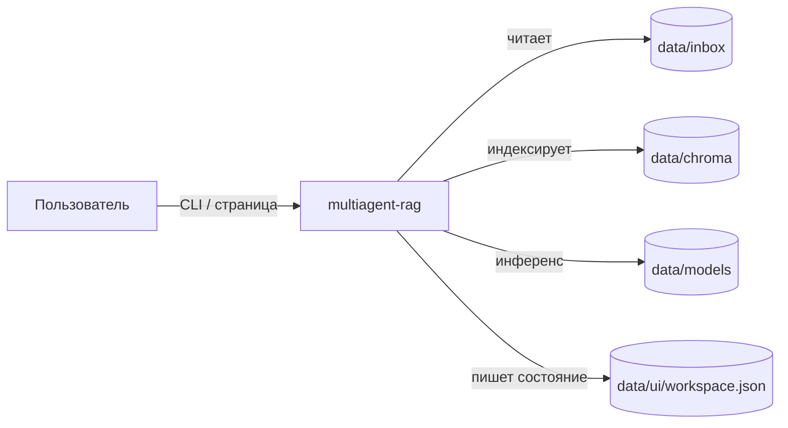
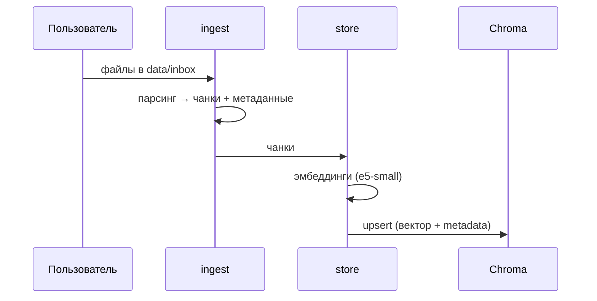
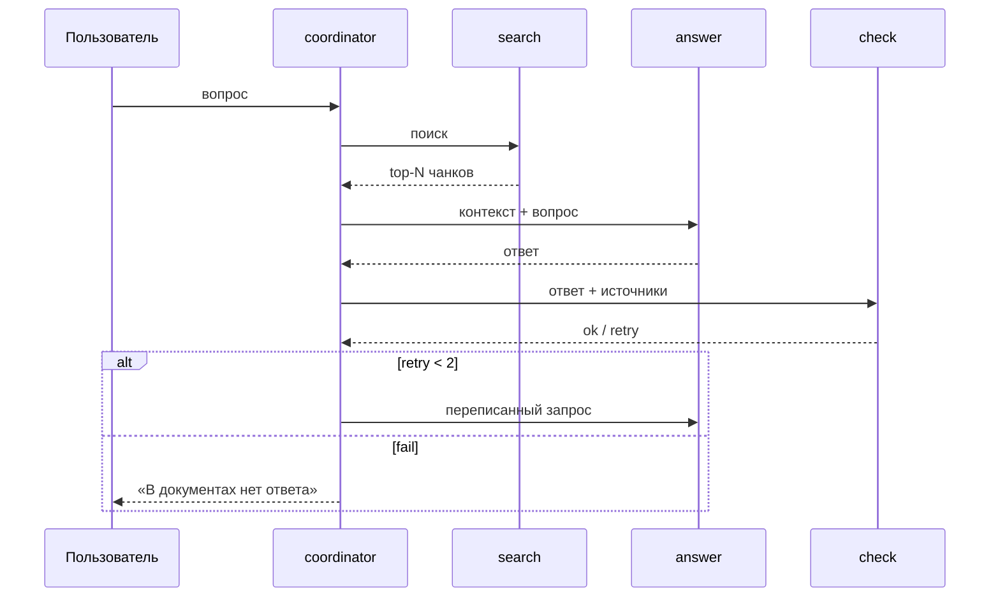

# Архитектура

> **Аудитория:** разработчики, архитекторы, DevOps.
> **Связанные документы:** [Обзор](00-overview.md) · [Data Science Deep Dive](02-data-science-deep-dive.md) · [Эксплуатация](03-operations.md)

## 1. Контекст системы

Система полностью локальна: внешних сетевых вызовов нет. Все артефакты — файлы в `data/`.

## 2. Контейнеры

| Блок | Назначение |
|---|---|
| `src/` | Код. Названий и фактов из документов здесь быть не должно |
| `data/inbox` | Исходные файлы |
| `data/chroma` | Индекс для поиска по смыслу |
| `data/models` | Файлы моделей (`multilingual-e5-small/`, `qwen2.5-1.5b-instruct-q4_k_m.gguf`) |
| `config/` | Лимиты, когда отвечать списком файлов, словарь проверки чисел |
| `data/prompts/` | Текст, который видит модель перед ответом, и примеры |
| `data/ui/workspace.json` | Диалоги, оценки 1–5 и дерево папок. В git не входит |
| `data/kbs/` | Отдельные базы и общие папки |
| `data/auth.sqlite` | Люди, пароли и права |
| `data/audit/` | Журнал |
| `data/users/` | Пользователи |
| `tests/eval/` | `floors.json`, `last.json` — пороги и последние измерения качества |

## 3. Компоненты и их роли

### 3.1 coordinator — оркестратор
Держит граф, управляет переходами, хранит состояние хода. Отвечает за маршрутизацию catalog-ветки vs RAG-ветки, счётчик переписываний (максимум 2), запись результата и оценки в `workspace.json`.

### 3.2 select — выбор прошлого хода
Решает, продолжается ли предыдущая тема или начинается новая.

### 3.3 clarify — уточнение
Если запрос неоднозначен — задаёт уточняющий вопрос вместо генерации.

### 3.4 search — гибридный поиск
Два канала: векторный (Chroma, косинусная близость эмбеддингов `multilingual-e5-small`) и пословный. Результаты объединяются и дедуплицируются.

### 3.5 answer — генерация
Собирает контекст из top-N чанков, подставляет в промпт из `data/prompts`, вызывает Qwen через `llama-cpp-python`.

### 3.6 check — верификация
Проверяет, что ответ опирается на источники. Особое внимание — числам: для них есть словарь/валидатор в `config/`. При провале — сигнал в coordinator на переписывание запроса.

### 3.7 ingest / store — загрузка и индексация
- **ingest**: чтение `data/inbox`, парсинг, чанкинг.
- **store**: эмбеддинги через `sentence-transformers`, запись в Chroma с метаданными.

### 3.8 access — доступ
Аутентификация CLI/API (`--user`, `CLI_PASSWORD`).

## 4. Потоки данных

### 4.1 Ingest

### 4.2 Query

## 5. Обоснования решений (ADR-стиль)

### ADR-1. Qwen2.5-1.5B по умолчанию, 7B — опция
CPU-инференс. 1.5B даёт приемлемую задержку; 7B доступен через `start.ps1 big` для машин с запасом RAM.

### ADR-2. `multilingual-e5-small`, а не крупные эмбеддинги
Мультиязычность (рус+англ), малый размер (~2.1 GB), быстрый инференс на CPU.

### ADR-3. Гибридный поиск (Chroma + пословный)
Векторный поиск плохо ловит точные термины и числа; пословный — наоборот. Объединение повышает recall.

### ADR-4. Отказ вместо галлюцинации
Для доверия важнее «не знаю», чем правдоподобный, но неверный ответ.

### ADR-5. LangGraph для оркестрации
Явный граф состояний и переходов, легко расширять агентов.

## 6. Ключевые параметры (config/)

- лимиты контекста;
- когда отвечать списком файлов;
- словарь проверки чисел.

Точные значения и имена параметров — в `config/`.

## 7. Что дальше

- Методология retrieval, эмбеддингов и верификации — [02-data-science-deep-dive.md](02-data-science-deep-dive.md).
- Запуск, мониторинг, roadmap — [03-operations.md](03-operations.md).